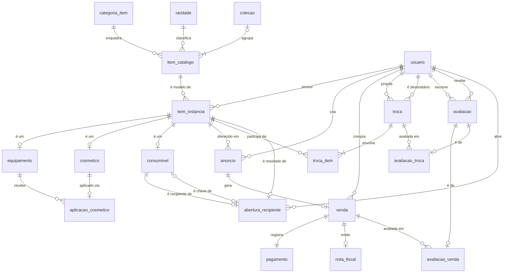

# Mapeamento do banco de dados — VaultGabe

Este documento descreve o banco usado pela aplicação: tabelas, chaves, relacionamentos, regras de negócio e os dados de demonstração disponíveis.

Os números foram obtidos executando `database/01_tabelas.sql` → `05_verificacao.sql` em um PostgreSQL de teste. A coluna "03" da seção 3 e as tabelas da seção 7 (exceto "Depois da ampliação") descrevem o banco montado só até o `03_dados.sql`; a coluna "03 + 04" é o banco completo, usado pelo site. Todas as contagens e as 25 regras de verificação retornaram `OK`. Também foi conferida a linha do tempo de posse de cada item: nenhum anúncio ou troca usa um item que não pertencia ao participante na data.

---

## 1. Visão geral

O banco tem **20 tabelas**, organizadas em sete áreas:

| Área | Tabelas | Para que serve na aplicação |
|---|---|---|
| **Catálogo** | `categoria_item`, `raridade`, `colecao`, `item_catalogo` | Os modelos de skins (ex.: "AK-47 \| Redline") e suas classificações |
| **Inventário** | `item_instancia`, `equipamento`, `cosmetico`, `consumivel`, `aplicacao_cosmetico` | Os exemplares que cada usuário possui, com float, StatTrak, adesivos aplicados etc. |
| **Usuários** | `usuario` | Os donos, vendedores e compradores |
| **Mercado** | `anuncio`, `venda`, `pagamento`, `nota_fiscal` | Anúncios publicados e vendas realizadas |
| **Trocas** | `troca`, `troca_item` | Trocas de itens entre usuários |
| **Avaliações** | `avaliacao`, `avaliacao_venda`, `avaliacao_troca` | Reputação dos usuários após vendas e trocas |
| **Aberturas** | `abertura_recipiente` | Histórico de caixas e cápsulas abertas |

> **Conceito central:** `item_catalogo` é o **modelo** ("AK-47 | Redline"), e `item_instancia` é um **exemplar** daquele modelo, com dono, float e número de inspeção próprios. Um modelo tem vários exemplares.

---

## 2. Diagrama

---

## 3. Tabelas

**Política de chaves:** toda tabela de entidade tem `id SERIAL` como chave primária, e a chave "natural" do negócio (nome, Steam ID, protocolo...) é mantida como `UNIQUE`. Os subtipos usam a mesma chave do registro pai.

| Tabela | O que guarda | Chave primária | Chave natural (`UNIQUE`) | Chaves estrangeiras | 03 | 03 + 04 |
|---|---|---|---|---|---:|---:|
| `categoria_item` | Categoria do modelo (Rifle, Faca, Caixa...) | `id` | `nome_categoria` | — | 13 | 13 |
| `raridade` | Raridade e sua cor (`#RRGGBB`) | `id` | `nome_raridade` | — | 12 | 12 |
| `colecao` | Coleção oficial e data de lançamento | `id` | `nome_colecao` | — | 12 | 29 |
| `usuario` | Conta do usuário (Steam ID, e-mail, apelido) | `id` | `steam_id`, `email` | — | 12 | 12 |
| `item_catalogo` | Modelo de item: nome, imagem, faixa de float, descrição | `id` | `nome_item` | `categoria_id`, `raridade_id`, `colecao_id` (opcional) | 21 | 80 |
| `item_instancia` | Exemplar de um modelo: dono atual, status, negociável | `id` | `numero_inspecao` | `item_catalogo_id`, `proprietario_id` → `usuario` | 54 | 297 |
| `equipamento` | Subtipo: armas, facas e luvas (float, seed, StatTrak, Souvenir) | `item_instancia_id` | — | `item_instancia_id` | 16 | 192 |
| `cosmetico` | Subtipo: adesivos e chaveiros | `item_instancia_id` | — | `item_instancia_id` | 20 | 56 |
| `consumivel` | Subtipo: caixas, cápsulas, chaves e grafites (lacrado, cargas) | `item_instancia_id` | — | `item_instancia_id` | 18 | 49 |
| `aplicacao_cosmetico` | Cosmético aplicado em um equipamento (posição, rotação, raspagem) | `cosmetico_id` | — | `cosmetico_id`, `equipamento_id` | 7 | 19 |
| `anuncio` | Item colocado à venda: preço, publicação, expiração, status | `id` | (`item_instancia_id`, `criador_id`, `data_publicacao`) | `item_instancia_id`, `criador_id` → `usuario` | 19 | 498 |
| `venda` | Venda gerada por um anúncio | `id` | `protocolo_venda`, `anuncio_id` | `anuncio_id`, `comprador_id` → `usuario` | 12 | 396 |
| `pagamento` | Pagamento da venda (método, valor, status) | `venda_id` | — | `venda_id` | 12 | 396 |
| `nota_fiscal` | Nota fiscal da venda (chave de 44 dígitos) | `id` | `chave`, `venda_id` | `venda_id` | 10 | 394 |
| `troca` | Proposta de troca entre dois usuários | `id` | `protocolo_troca` | `proponente_id`, `destinatario_id` → `usuario` | 10 | 10 |
| `troca_item` | Itens de cada troca e o lado (oferecido ou solicitado) | (`troca_id`, `item_instancia_id`) | — | `troca_id`, `item_instancia_id` | 21 | 21 |
| `avaliacao` | Nota (1 a 5) e comentário de um usuário sobre outro | `id` | `ticket_avaliacao` | `autor_id`, `avaliado_id` → `usuario` | 10 | 158 |
| `avaliacao_venda` | Liga a avaliação a uma venda | `avaliacao_id` | — | `avaliacao_id`, `venda_id` | 5 | 153 |
| `avaliacao_troca` | Liga a avaliação a uma troca | `avaliacao_id` | — | `avaliacao_id`, `troca_id` | 5 | 5 |
| `abertura_recipiente` | Abertura de caixa/cápsula: recipiente, chave e item obtido | `id` | `recipiente_id`, `chave_id`, `item_resultado_id` | `usuario_id`, `recipiente_id`, `chave_id`, `item_resultado_id` | 5 | 5 |

### Restrições de valor e unicidade mais importantes

| Tabela | Regra |
|---|---|
| `raridade` | `cor_hexadecimal` no formato `#RRGGBB` |
| `usuario` | `email` com formato `algo@algo.algo` |
| `item_catalogo` | `float_min` e `float_max` ambos preenchidos ou ambos vazios, dentro de [0, 1] e com `min ≤ max` |
| `equipamento` | `float_value` em [0, 1]; `paint_seed` em [0, 1000]; nunca StatTrak **e** Souvenir ao mesmo tempo |
| `consumivel` | `cargas_restantes ≥ 0`; item lacrado tem pelo menos 1 carga |
| `aplicacao_cosmetico` | `nivel_raspagem` em [0, 100]; `rotacao` em [−360, 360] |
| `anuncio` | `preco > 0`; `data_expiracao > data_publicacao`; **no máximo 1 anúncio aberto (`pendente`/`ativo`) por item** (índice único parcial `anuncio_aberto_por_item_uk`) |
| `venda` / `pagamento` / `nota_fiscal` | valores `> 0`; pagamento pendente sem data, aprovado/recusado com data |
| `troca` | proponente ≠ destinatário; só troca `concluida` tem `data_efetivacao` |
| `avaliacao` | `nota` de 1 a 5; autor ≠ avaliado |
| `abertura_recipiente` | recipiente, chave e resultado são itens diferentes |

---

## 4. Relacionamentos e cardinalidades

| Relacionamento | Entre | Cardinalidade | Como é implementado |
|---|---|---|---|
| Enquadra | modelo → categoria | cada modelo tem 1 categoria | FK `NOT NULL` |
| Classifica | modelo → raridade | cada modelo tem 1 raridade | FK `NOT NULL` |
| Pertence | modelo → coleção | cada modelo tem 0 ou 1 coleção; cada coleção tem ≥ 1 modelo | FK opcional + regra RS-18 |
| Modelo de | exemplar → modelo | cada exemplar é de 1 modelo | FK `NOT NULL` |
| Possui | exemplar → usuário | cada exemplar tem 1 dono **atual** | FK `NOT NULL` (muda quando vende ou troca) |
| Especialização | exemplar → equipamento \| cosmético \| consumível | exatamente 1 subtipo (total e disjunta) | chave compartilhada + RS-01, RS-02 |
| Aplica | cosmético → equipamento | 1 cosmético em ≤ 1 equipamento; equipamento com ≤ 6 cosméticos | PK + triggers (ver 6.1) |
| Cria | anúncio → usuário | cada anúncio tem 1 criador | FK `NOT NULL` |
| Oferece | anúncio → exemplar | um exemplar pode ter vários anúncios ao longo do tempo, mas só 1 aberto | FK `NOT NULL` + índice único parcial |
| Gera | venda → anúncio | 1 anúncio gera no máximo 1 venda | FK `NOT NULL` + `UNIQUE` |
| Compra | venda → usuário | cada venda tem 1 comprador | FK `NOT NULL` |
| Registra | pagamento ↔ venda | 1 para 1 | chave compartilhada + RS-06 |
| Emite | nota fiscal → venda | cada venda tem 0 ou 1 nota | FK `NOT NULL` + `UNIQUE` |
| Propõe / Destinatário | troca → usuário (×2) | cada troca tem 1 proponente e 1 destinatário | 2 FKs `NOT NULL` |
| Envolve | troca ↔ exemplar | muitos para muitos, com atributo `lado_troca` | tabela `troca_item` + RS-08 |
| Escreve / Recebe | avaliação → usuário (×2) | cada avaliação tem 1 autor e 1 avaliado | 2 FKs `NOT NULL` |
| Avalia venda / troca | avaliação → venda **ou** troca | exatamente um dos dois | subtipos + RS-09 |

> **Cosméticos aplicados:** como no CS2, aplicar um adesivo ou chaveiro o **incorpora à arma**. Ele precisa ser do mesmo dono, passa a `consumido` (deixa de ser negociável sozinho) e acompanha a arma quando ela é vendida ou trocada.

---

## 5. Valores de status

Os valores são gravados **sem acento**. A interface pode exibi-los com acento.

| Coluna | Valores possíveis | Padrão |
|---|---|---|
| `item_instancia.status_item` | `disponivel`, `bloqueado`, `consumido` | `disponivel` |
| `anuncio.status_anuncio` | `pendente`, `ativo`, `vendido`, `expirado`, `cancelado` | **`pendente`** |
| `venda.status_venda` | `pendente`, `concluida`, `cancelada` | `pendente` |
| `pagamento.status_pagamento` | `pendente`, `aprovado`, `recusado` | `pendente` |
| `pagamento.metodo_pagamento` | `pix`, `cartao_credito`, `cartao_debito`, `boleto`, `saldo_steam` | — |
| `troca.status_troca` | `pendente`, `aceita`, `recusada`, `cancelada`, `concluida` | `pendente` |
| `troca_item.lado_troca` | `oferecido`, `solicitado` | — |
| `cosmetico.tipo_cosmetico` | `adesivo`, `chaveiro` | — |
| `consumivel.tipo_consumivel` | `caixa`, `capsula`, `chave`, `grafite` | — |

Um anúncio está **aberto** quando o status é `pendente` ou `ativo`, e **encerrado** quando é `vendido`, `expirado` ou `cancelado`.

---

## 6. Regras de negócio

### 6.1 Garantidas pelo banco (triggers em `02_regras.sql`)

O banco **recusa** a operação que viola a regra e devolve uma mensagem de erro, que a aplicação pode exibir ao usuário.

| # | Trigger | Tabela | Quando | O que faz |
|---:|---|---|---|---|
| 1 | `trg_limite_cosmeticos` | `aplicacao_cosmetico` | antes de INSERT/UPDATE | Bloqueia o 7º cosmético em um mesmo equipamento |
| 2 | `trg_vendedor_nao_compra` | `venda` | antes de INSERT/UPDATE | Bloqueia a venda em que o comprador é o próprio criador do anúncio |
| 3 | `trg_aplicar_cosmetico` | `aplicacao_cosmetico` | antes de INSERT | Exige cosmético do mesmo dono da arma, disponível, negociável e sem anúncio aberto; depois o marca como `consumido` e não negociável |
| 4 | `trg_cosmeticos_acompanham_equipamento` | `item_instancia` | depois de mudar o dono | Leva os cosméticos aplicados para o novo dono da arma |
| 5 | `trg_validar_anuncio` | `anuncio` | antes de INSERT/UPDATE | Anúncio aberto só para item **do próprio criador**, `disponivel` e negociável |
| 6 | `trg_transicao_anuncio` | `anuncio` | antes de mudar o status | Ciclo de vida: `pendente → ativo`; `ativo → vendido` só com venda concluída; cancelar ou expirar só sem venda pendente (e expirar só depois do vencimento); `vendido`, `expirado` e `cancelado` são finais |
| 7 | `trg_validar_avaliacao_venda` | `avaliacao_venda` | antes de INSERT/UPDATE | Só venda concluída; autor e avaliado são o comprador e o vendedor; não pode ser anterior à venda; uma avaliação por autor; não pode estar ligada também a uma troca |
| 8 | `trg_validar_avaliacao_troca` | `avaliacao_troca` | antes de INSERT/UPDATE | As mesmas regras do trigger 7, para trocas concluídas |
| — | `trg_registrar_abertura_recipiente` | `abertura_recipiente` | antes de INSERT | Valida recipiente e chave (sem anúncio aberto) e o resultado; marca recipiente e chave como `consumido` |
| — | `trg_proteger_abertura_recipiente` | `abertura_recipiente` | antes de UPDATE/DELETE | Impede alterar ou apagar o histórico de aberturas |

Além dos triggers, o índice `anuncio_aberto_por_item_uk` impede **dois anúncios abertos para o mesmo item**.

### 6.2 Conferidas por `05_verificacao.sql`

| Regra | Descrição | Também bloqueada na inserção? |
|---|---|---|
| RS-01, RS-02 | Todo exemplar está em exatamente 1 subtipo | Não |
| RS-03 | Equipamento com no máximo 6 cosméticos | **Sim** (trigger 1) |
| RS-04 | Venda concluída ⇒ item com o comprador (se não mudou de dono depois) | Não |
| RS-05 | Comprador nunca é o criador do anúncio | **Sim** (trigger 2) |
| RS-06 | Toda venda tem 1 pagamento | Não |
| RS-07 | Troca concluída ⇒ oferecidos com o destinatário e solicitados com o proponente (se não mudaram de dono depois) | Não |
| RS-08 | Toda troca tem ≥ 1 item oferecido e ≥ 1 solicitado | Não |
| RS-09 | Toda avaliação é de uma venda **ou** de uma troca | Em parte: os triggers 7 e 8 impedem as duas ao mesmo tempo, e `fn_avaliar_venda` já cria a avaliação no subtipo |
| RS-10 | Anúncio `vendido` ⇔ existe venda `concluida` | **Sim**, ao mudar o status (trigger 6) |
| RS-11 | Float do exemplar dentro da faixa do modelo | Não |
| RS-12, RS-13 | Nota fiscal e pagamento com o mesmo valor da venda | Não |
| RS-14 | Exemplares do mesmo modelo caem no mesmo subtipo | Não |
| RS-15 | Faixa de float só em modelos de equipamento | Não |
| RS-16 | Pagamento recusado ⇒ venda cancelada | Não |
| RS-17 | Anúncio ativo ⇒ criador é o dono atual do item | **Sim** (trigger 5) |
| RS-18 | Toda coleção tem ≥ 1 modelo | Não |
| RS-19 a RS-22 | Aberturas válidas e recipientes consumidos | **Sim** (trigger de abertura) |
| RS-23 | Cosmético aplicado: mesmo dono da arma, consumido e não negociável | **Sim** (triggers 3 e 4) |
| RS-24 | Anúncio aberto ⇒ item disponível e negociável | **Sim** (trigger 5; a abertura e a aplicação de cosmético também recusam item com anúncio aberto) |
| RS-25 | Avaliação entre as partes de uma operação concluída, depois dela, uma por autor | **Sim** (triggers 7 e 8) |

Uma compra feita por `fn_comprar_anuncio` (seção 6.3) já cumpre RS-04, RS-06, RS-10, RS-12 e RS-13 por construção.

### 6.3 Funções chamadas pela aplicação

Operações de várias etapas ficam no próprio banco. Cada chamada é atômica: se uma etapa falhar, nada é gravado. Todos os triggers continuam valendo para o que a função grava.

| Função | O que faz | Retorna |
|---|---|---|
| `fn_comprar_anuncio(anuncio, comprador, metodo)` | Confere o anúncio (ativo, não vencido, sem venda) e o item; cria a venda `concluida`, o pagamento `aprovado` e a nota fiscal; marca o anúncio como `vendido`; passa o item e os cosméticos aplicados ao comprador | `venda_id`, `protocolo`, `chave_nota_fiscal` |
| `fn_avaliar_venda(venda, autor, nota, comentario)` | Descobre o avaliado (a outra parte da venda) e grava a avaliação já ligada à venda | ticket (`TKT-AAAA-NNNN`) |
| `fn_expirar_anuncios()` | Marca como `expirado` os anúncios abertos já vencidos, exceto os que têm venda pendente | quantidade expirada |
| `fn_gerar_chave_nfe(numero)` | Gera a chave de 44 dígitos da nota fiscal, com dígito verificador (módulo 11) | chave |
| `fn_desgaste(float)` / `fn_desgaste_nome(float)` | Desgaste a partir do float: `FN` Factory New (< 0,07), `MW` Minimal Wear (< 0,15), `FT` Field-Tested (< 0,38), `WW` Well-Worn (< 0,45), `BS` Battle-Scarred | código / nome |
| `fn_sem_acento(texto)` | Texto em minúsculas e sem acento, para a busca e a ordem alfabética do catálogo (`buscar_catalogo`, `listar_categorias`, `listar_colecoes`) e do inventário (`inventario_usuario`) | texto |
| `fn_media_vendas_comparaveis(item)` | Média das vendas concluídas para a análise de preço: as do mesmo modelo e da mesma versão do item (desgaste, StatTrak e Souvenir) quando são 2 ou mais; senão, ou fora de equipamento, todas as vendas do modelo. A página da skin (`ofertas_do_modelo`) e o Novo anúncio (`analise_preco_anuncio`) usam a mesma conta | `preco_medio` (sem arredondar), `vendas`, `base` (`versao` ou `modelo`) |

- **Numeração sem buracos:** os protocolos (`VND-AAAA-NNNN`) e os tickets (`TKT-AAAA-NNNN`) vêm das sequências `venda_protocolo_seq` e `avaliacao_ticket_seq`, que continuam a partir dos dados de demonstração. O número só é gerado depois que todas as validações passam, então uma compra ou avaliação recusada não pula números.
- **Índices novos:** `idx_venda_data` (histórico e estatísticas por período) e `idx_anuncio_ativo_expiracao` (vencimento dos anúncios ativos).
- **Visões de apoio** (em `01_tabelas.sql`), usadas pelas consultas de `database/consultas/`: `vw_ofertas_ativas` (anúncios ativos e não vencidos; a coluna `reservada` marca os que têm venda pendente, que continuam listados mas ficam fora do menor preço e da contagem de ofertas), `vw_vendas_concluidas` (vendas concluídas com item, modelo, vendedor e comprador) e `vw_reputacao` (nota média e número de avaliações por usuário).

---

## 7. Dados disponíveis

As tabelas desta seção descrevem os dados de `03_dados.sql` (a base herdada de Banco de Dados I, usada também pelos testes). O `04_dados_ampliados.sql` acrescenta o volume usado pelas telas e pelos gráficos (ver "Depois da ampliação", no fim da seção).

### Usuários

| id | Apelido | Nome | Itens | Negociáveis | Anúncios ativos | Compras | Vendas | Nota média |
|---:|---|---|---:|---:|---:|---:|---:|---:|
| 1 | galabinha | Ana Ribeiro | 3 | 1 | 0 | 0 | 4 | 4,0 |
| 2 | viniciuslabubu | Bruno Carvalho | 7 | 5 | 1 | 0 | 0 | 5,0 |
| 3 | manojoe | Carla Menezes | 3 | 2 | 0 | 0 | 2 | 3,0 |
| 4 | dfontes | Diego Fontes | 7 | 6 | 1 | 2 | 0 | — |
| 5 | lisa | Elisa Moraes | 3 | 2 | 0 | 0 | 2 | — |
| 6 | pepaa | Felipe Andrade | 3 | 3 | 1 | 0 | 0 | 4,0 |
| 7 | gabs | Gabriela Souza | 1 | 1 | 0 | 0 | 2 | — |
| 8 | rick | Henrique Lopes | 3 | 2 | 0 | 0 | 0 | — |
| 9 | isizinha | Isabela Prado | 11 | 7 | 0 | 4 | 0 | 4,5 |
| 10 | JV | João Vitor Nunes | 2 | 2 | 1 | 0 | 0 | — |
| 11 | lari | Larissa Teixeira | 6 | 5 | 2 | 3 | 0 | 5,0 |
| 12 | bruninmatador | Marcelo Dias | 5 | 4 | 0 | 1 | 0 | 4,0 |

*"Itens" inclui os cosméticos aplicados nas armas do usuário. "Negociáveis" = itens `disponivel` com `tradable_flag = true`, inclusive os que já têm anúncio aberto (o Inventário mostra à parte os "Prontos para anunciar").*

### Itens

| Tipo | Disponíveis e negociáveis | Bloqueados | Consumidos | Total |
|---|---:|---:|---:|---:|
| Equipamento | 15 | 1 | 0 | 16 |
| Cosmético | 13 | 0 | 7 (aplicados em armas) | 20 |
| Consumível | 12 | 0 | 6 (caixas, chaves e cápsulas abertas) | 18 |
| **Total** | **40** | **1** | **13** | **54** |

São **21 modelos** em 13 categorias, todos itens reais do CS2 com a imagem oficial. As categorias com mais modelos são Rifle e Luva, com 3 cada.

### Mercado

| | Quantidade | Detalhe |
|---|---:|---|
| Anúncios ativos | 6 | de R$ 35,00 (P90) a R$ 10.500,00 (M4A4 \| Howl) |
| Anúncios vendidos | 10 | |
| Anúncios cancelados / expirados | 2 / 1 | |
| Vendas concluídas | 10 | R$ 19.967,40 no total, entre 06/01/2026 e 02/02/2026 |
| Vendas pendente / cancelada | 1 / 1 | a pendente (`VND-2026-0011`, boleto) fica em aberto de propósito, para mostrar a venda pendente e a oferta reservada |
| Trocas | 10 | 5 concluídas, 2 pendentes, 1 aceita, 1 recusada, 1 cancelada; as 2 pendentes e a aceita ficam abertas de propósito, para mostrar todos os status |
| Avaliações | 10 | notas de 2 a 5 |

**Anúncios ativos no 03:**

| Item | Vendedor | Preço | Expira em |
|---|---|---:|---|
| M4A4 \| Howl *(com 1 adesivo aplicado)* | lari | R$ 10.500,00 | 10/04/2027 |
| Karambit \| Doppler | lari | R$ 5.900,00 | 11/04/2027 |
| Desert Eagle \| Blaze | JV | R$ 1.950,00 | 12/04/2027 |
| AWP \| Asiimov | dfontes | R$ 1.100,00 | 01/04/2027 |
| Cápsula Ambush *(com venda pendente: aparece como reservada e não entra no menor preço; no 04 vira Cápsula Katowice 2014 Challengers, a R$ 6,80)* | viniciuslabubu | R$ 680,00 | 30/04/2027 |
| P90 \| Sand Spray | pepaa | R$ 35,00 | 02/04/2027 |

### Depois da ampliação (`04_dados_ampliados.sql`)

| | 03 | 03 + 04 |
|---|---:|---:|
| Modelos (`item_catalogo`) | 21 | **80**, todos itens reais do CS2 com a imagem oficial |
| Coleções | 12 | 29 |
| Exemplares (`item_instancia`) | 54 | **297** (192 equipamentos, 56 cosméticos, 49 consumíveis) |
| Vendas concluídas | 10 | **394**, de novembro/2025 a outubro/2026, com vendas em todos os 12 meses |
| Avaliações | 10 | 158 |
| Anúncios ativos | 6 | **80**, todos vencendo em 2027 |
| Anúncios cancelados / expirados | 2 / 1 | 15 / 9 |

- **Todos os 80 modelos têm 3 ou mais vendas**, o que garante dados para o gráfico de preço do Detalhe e para os rankings da Análise.
- **Os preços são simulados** (preço de referência do modelo × desgaste × StatTrak ou Souvenir × tendência mensal × variação de ±7%), e a interface avisa isso.
- **Steam Guard pesa na reputação:** a Steam segura por até 15 dias os itens enviados por contas sem o autenticador móvel, o que atrasa a entrega das vendas. Por isso os vendedores com `steam_guard_ativo = FALSE` (dfontes, pepaa, isizinha e bruninmatador) recebem notas de 2 a 4, com comentários sobre a demora na entrega, escritos mais de 15 dias depois da venda (quando o item chega); quem compra deles também só anuncia o item depois desse prazo. Na nota média do perfil, esses quatro ficam entre 3,1 e 3,8, e os demais entre 4,0 e 4,5. O site mostra o aviso no perfil, ao lado do vendedor nas ofertas e na janela Comprar. A retenção é simulada só nas vendas do 04: as trocas herdadas do BD I foram efetivadas no dia seguinte à proposta, e a compra feita pelo site entrega o item na hora (a janela de compra avisa).
- O script é **determinístico**: os "sorteios" usam `md5` de um texto fixo, e não `random()`. Rodar de novo gera os mesmos dados.
- A linha do tempo de posse continua coerente: cada anúncio é publicado por quem era dono do item naquela data, e as revendas vêm depois da compra anterior. O `05_verificacao.sql` retorna `OK` em todas as contagens e regras.
- A numeração segue a ordem de cadastro: as vendas do 03 (jan–fev/2026) mantêm `VND-2026-0001` a `0012`, e as do 04 continuam de `0013`, inclusive as de nov–dez/2025 (`VND-2025-0013` em diante; o mesmo vale para os tickets e para o número da nota fiscal).

**Usuários indicados para demonstração** (banco completo, usado pelo site):
- Isabela (`isizinha`): usuária padrão e maior compradora (41 compras), com a AK-47 \| Redline com 3 adesivos aplicados.
- Diego (`dfontes`): vendedor sem Steam Guard (aviso no perfil, nas ofertas e na janela Comprar), com 6 anúncios ativos.
- Larissa (`lari`): revendedora, com 9 anúncios ativos, entre eles a M4A4 \| Howl e a Karambit \| Doppler.

As tabelas usadas por cada página estão em [`escopo.md`](escopo.md), seção 5.

---

## 8. Correções em relação ao BD I

As correções abaixo foram feitas sobre o banco do BD I: as regras ficam em `01_tabelas.sql` e `02_regras.sql`, e os dados em `03_dados.sql` e na seção 11 do `04_dados_ampliados.sql`.

| Problema | Correção |
|---|---|
| O banco aceitava anúncio de item **de outro usuário**, bloqueado ou consumido | Trigger `trg_validar_anuncio` + regra RS-24 |
| O mesmo item podia ter **dois anúncios abertos** e ser vendido duas vezes | Índice único parcial `anuncio_aberto_por_item_uk` |
| **Cosméticos aplicados** tinham dono diferente da arma (6 de 7) e continuavam negociáveis; havia chaveiro em faca | Triggers 3 e 4 + regra RS-23; as 7 aplicações agora usam cosméticos do próprio dono da arma e só armas de fogo |
| **Três trocas** usavam itens que já eram de outra pessoa na data da proposta (`TRC-2026-0006`, `0009` e `0010`) | Itens e participantes ajustados em `03_dados.sql` |
| A troca aceita `TRC-2026-0008` oferecia uma faca **bloqueada** e pedia uma cápsula que já estava em **venda pendente** | Trocada por Nova ↔ AK-47 (ambas Classified) |
| RS-04 e RS-07 acusariam erro em qualquer **revenda** feita pela aplicação | Passaram a considerar só a transferência mais recente do item |
| Anúncio novo nascia `pendente` e não havia regra para as mudanças de status | A aplicação publica direto como `ativo`; o trigger 6 controla o ciclo de vida |
| Venda concluída não transferia o item, e a compra exigia vários comandos separados | Função `fn_comprar_anuncio`, atômica |
| Anúncio vencido continuava `ativo` | Função `fn_expirar_anuncios`, chamada pela aplicação antes de listar |
| Não havia regra para quem pode avaliar | Triggers 7 e 8, regra RS-25 e função `fn_avaliar_venda` |
| Não há senha em `usuario` | Seletor "Entrar como" (ver `escopo.md`) |
| A moeda não é registrada | A interface exibe sempre em R$ (ver `escopo.md`) |
| Não havia imagens (`imagem_base` apontava para arquivos `img/*.png` inexistentes) | Cada modelo recebeu o link da imagem oficial (servidor da Steam), obtido no [CSGO-API](https://github.com/ByMykel/CSGO-API); `imagem_base` virou `TEXT`, porque os links passam de 255 caracteres (o maior tem 287). Se um link falhar, o site mostra o nome do item na cor da raridade |
| Dois modelos não existiam no jogo | `P90 \| Dry Season` virou a skin real `P90 \| Sand Spray` (mesma arma, raridade e descrição, com a faixa de float real: 0,06 a 0,80). A `Capsula de Chaveiros` saiu (no CS2 chaveiros não vêm em cápsula): suas 2 unidades viraram `Capsula Ambush`, e o que saiu delas virou adesivo |
| Raridades diferentes das do jogo | 8 modelos alinhados com o CS2 (ex.: Karambit agora é Covert; Adesivo Crown (Foil) é Exotic) |
| Alguns modelos do 03 estavam em coleções diferentes das do jogo, e dois nomes de coleção eram de caixa/operação (`The Danger Zone Case`, `Operation Bravo`); 5 chaveiros tinham sido obtidos antes de existirem no jogo | Seção 11.1 do 04, conferida com o CSGO-API: modelos nas coleções certas, nomes trocados por `The Danger Zone Collection` e `The Bravo Collection`, 2 coleções novas sem data de lançamento confirmada (`The Dust 2 Collection` e `Small Arms Charm Collection`) e a `The Cache Collection` removida, porque ficou vazia quando a AK-47 \| Redline passou para a The Phoenix Collection; as datas de obtenção de 5 dos 6 chaveiros do 03 passam para depois de 02/10/2024, quando os chaveiros chegaram ao jogo |
| Variantes que não existem no jogo: uma Desert Eagle \| Blaze StatTrak e um AWP \| Asiimov Souvenir | Seção 11.2 do 04: os dois exemplares passam a comuns |
| A Cápsula Ambush estava anunciada (e vendida, com pagamento pendente) por R$ 680,00, cerca de cem vezes o preço das outras vendas do modelo | Seção 11.3 do 04: anúncio, venda e pagamento passam a R$ 6,80 |
| As aberturas davam itens que não saem daqueles recipientes (Caixa Fracture → AK-47 \| Redline; Cápsula Ambush → adesivos de outras cápsulas), e a chave era a do CS:GO, que não abre a caixa | Seção 11.4 do 04: a caixa vira Caixa Phoenix (a da Redline), a chave vira Chave da Caixa Phoenix, a cápsula vira Cápsula Katowice 2014 Challengers (a do adesivo Natus Vincere (Holo)) e o adesivo da 5ª abertura passa a ser Natus Vincere (Holo) |
| Chaves de NF-e do 03 com dígito verificador errado (9 de 10) e uma com o mês errado | Chaves recalculadas no `03_dados.sql` com o mesmo módulo 11 de `fn_gerar_chave_nfe` |
| Cor da raridade Extraordinary diferente da do CS2 (`#ffd700`) | `#eb4b4b`, a cor usada pelo jogo |
| Laudos de duas trocas não batiam com os itens (`TRC-2026-0003` e `0004`) | Textos corrigidos no `03_dados.sql` |
| Detalhes dos usuários e dos itens | Apelidos de 4 usuários, datas de cadastro variadas, chaveiro aplicado sem nível de raspagem (chaveiro não raspa) e comentário da `TKT-2026-0003` falando do item, e não de troca (é a avaliação de uma venda) |
| Os scripts são ASCII, então nomes, comentários e descrições apareciam sem acento na tela ("Capsula", "negociacao") | A seção 11.5 do 04 grava os acentos com escape Unicode (`U&'\00E1'`), sem deixar de ser ASCII; a busca do catálogo usa `fn_sem_acento` e encontra "capsula" ou "cápsula" |

### Ajustes da aplicação e da hospedagem

Ajustes feitos durante o desenvolvimento da aplicação, sem relação com o BD I:

| Problema | Correção |
|---|---|
| O Neon usa o fuso UTC, e as datas gravadas com `now()` ficariam 3 horas adiantadas | Banco configurado com `timezone = America/Sao_Paulo` nas duas branches |
| O driver do Node convertia `DATE` e `TIMESTAMP` para o fuso do servidor, e as datas apareciam deslocadas | `src/banco.js` recebe datas como texto, já no horário de São Paulo |
| Protocolo e ticket usavam `lpad(numero, 4)`: a partir da venda 10.000 o número era cortado e repetia protocolos | O número tem pelo menos 4 dígitos e cresce depois de 9999 (`fn_comprar_anuncio` e `fn_avaliar_venda`) |
| Duas avaliações da mesma compra enviadas ao mesmo tempo passavam as duas; um anúncio publicado durante a compra do anúncio anterior do mesmo item via o dono antigo | `fn_avaliar_venda` trava a venda e o trigger 5 e `fn_comprar_anuncio` travam o item (`FOR UPDATE`) |
| O ranking "Vendedores mais bem avaliados" misturava notas de compras e de trocas | Passou a usar só as notas recebidas nas vendas (`vendedores_mais_bem_avaliados`) |

---

## 9. Limitações tratadas

Duas limitações identificadas nos dados de demonstração foram tratadas:

| # | Limitação | Solução |
|---:|---|---|
| 1 | Poucos dados para estatísticas (1 venda por modelo) | `04_dados_ampliados.sql`: 394 vendas simuladas em 12 meses; todo modelo tem 3 ou mais vendas |
| 2 | Anúncios de demonstração vencendo em dezembro/2026 | Os 6 do 03 passaram a vencer em abril/2027, e os do 04 vencem entre abril e setembro de 2027 |
